

  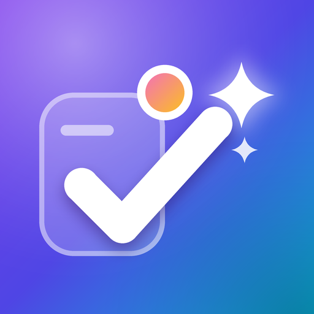

<h1 align="center">MegaDo</h1>

<b>To-do list, notes, reminders and 75 tools for Android and Windows</b> 
Alarms with snooze · clock with repeating timers · location reminders · notes with photos, drawings, voice and Markdown · document scanner · market prices · PC remote · sync through your own Google Drive

  <a href="https://github.com/MegaMind2999/MegaDoApk/releases/latest/download/MegaDo.apk"><b>⬇ Download MegaDo.apk (latest)</b></a>
  &nbsp;·&nbsp;
  <a href="https://github.com/MegaMind2999/MegaDoApk/releases/latest/download/MegaDo-Setup.exe"><b>⬇ MegaDo for Windows</b></a>
  &nbsp;·&nbsp;
  <a href="https://github.com/MegaMind2999/MegaDoApk/releases/latest">Release notes</a>
  &nbsp;·&nbsp;
  <a href="https://megamind2999.github.io/MegaDoApk/">Website</a>

Free · No ads · No tracking · Android 7.0+ · phones and tablets · Windows 10 and 11

---

## What is MegaDo?

MegaDo puts your to-do list, your notes, your reminders and your clock in one place. Type or say a task in plain words like *"Call mom tomorrow 5pm high"* and MegaDo fills in the date, time, priority and reminder. Choose how loudly each reminder gets your attention, from a quiet notification to a full-screen alarm, snooze it for as long as you like, or have it remind you when you arrive somewhere instead of at a time.

Notes can mix text, checklists, photos, hand drawings, voice recordings and Markdown, and a photo of a page becomes a clean scan. A Tools tab holds 75 handy tools, from a QR scanner and prayer times to live market prices and a remote for your PC. Everything lives on your device, and if you use more than one, MegaDo keeps your phone, tablet and PC in sync through a hidden folder in your own Google Drive.

  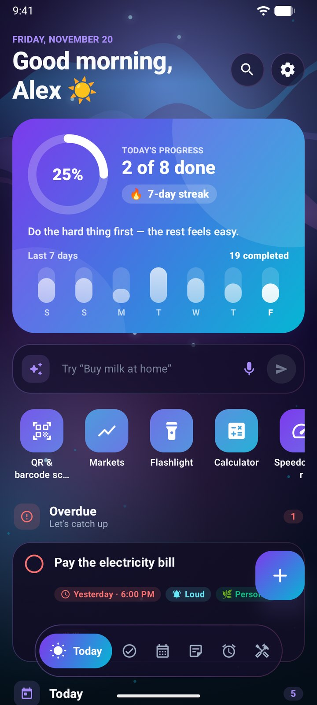
  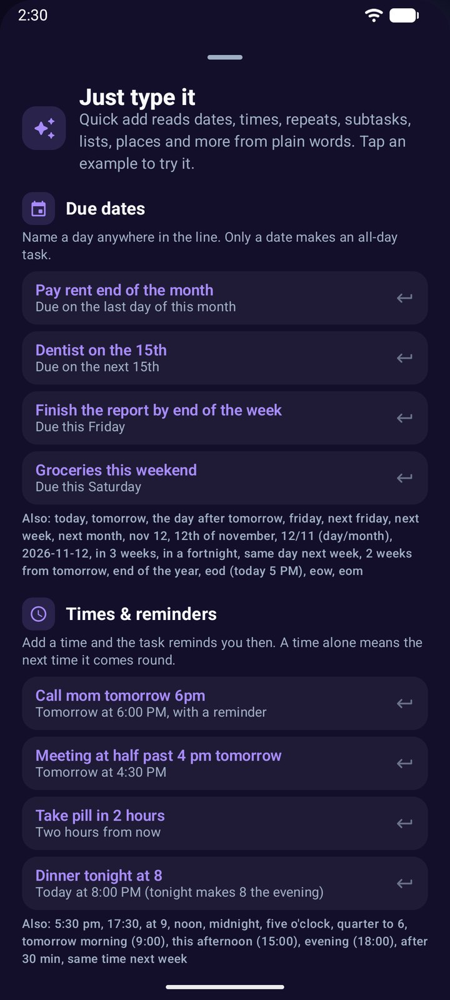
  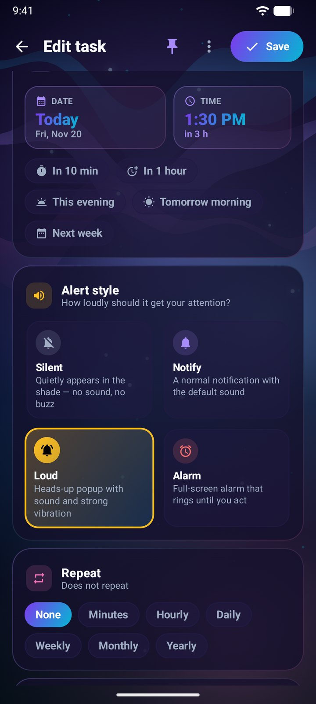
  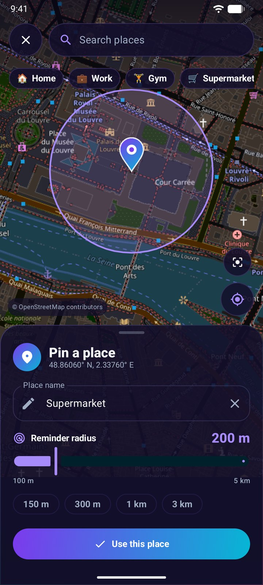
  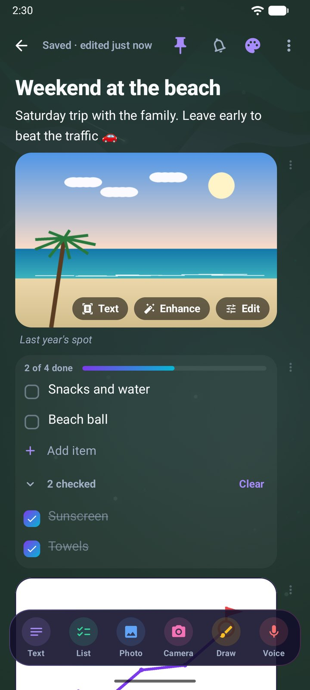
  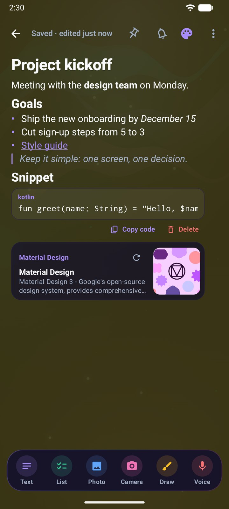
  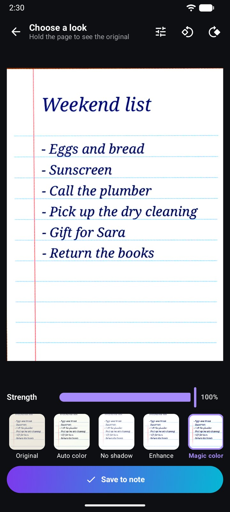
  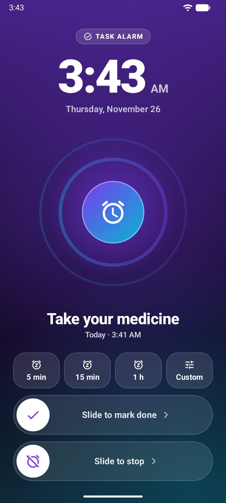
  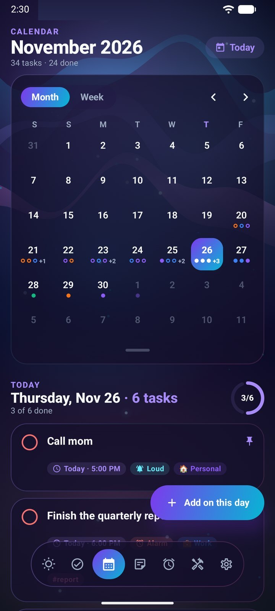
  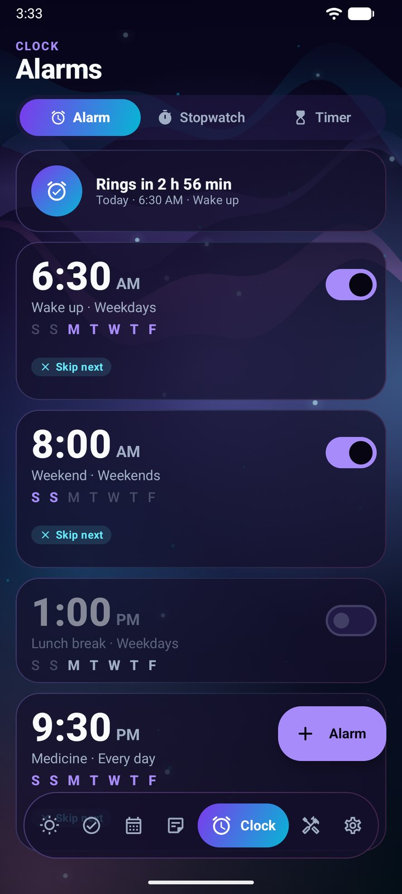
  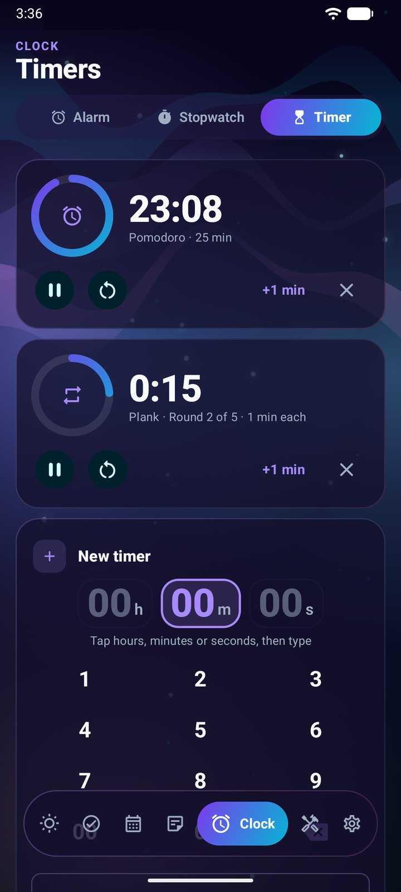
  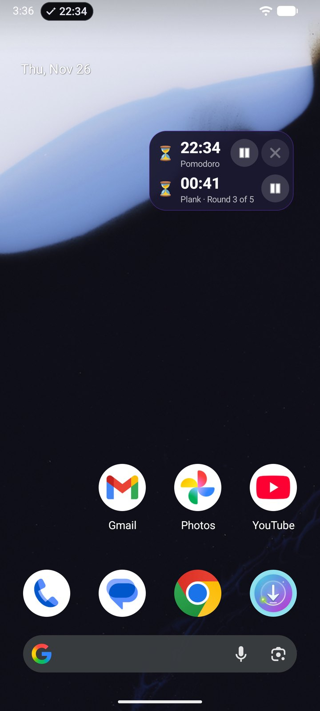
  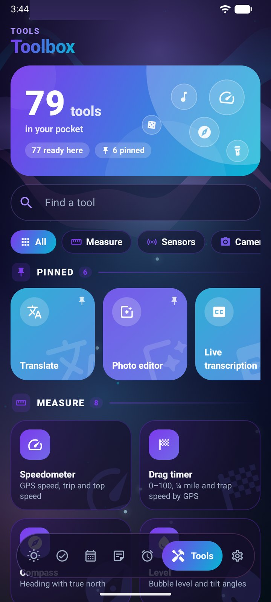
  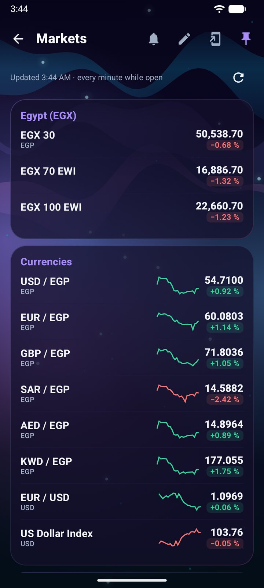

## Features

**Tasks**
- Lists, subtasks, priorities, tags and pinning
- Today view with overdue, today and the next 7 days, plus your streak and weekly progress
- Quick add in plain words: "Groceries every week", "Standup every weekday at 9:30"
- Quick add by voice with the phone's own speech recognizer: "Gym same day next week at 7 a.m. high"
- Quick add with places: "Buy milk at home", "Call Ali when I leave work", `notify me at the gym to "stretch first"`
- Calendar by month or week (pull the month down to fill the screen with your events), and search across tasks and notes
- Phone calendar: see your Google or phone calendar events next to your tasks, and optionally add dated tasks to your calendar
- Quick add guide: tap the sparkle for everything it understands, with examples you can try
- Home-screen widget to check off today's tasks

**Reminders**
- Alert style per reminder: silent, notification, loud, or full-screen alarm
- Snooze for minutes, hours or a custom time
- Repeat every few minutes, hourly, daily, weekly on chosen days, monthly or yearly, with an optional end date
- "Keep reminding me until done" re-alerts every few minutes
- Location reminders: draw a circle on the map, get reminded when you arrive or leave
- Saved places: keep Home, Work, the gym and more (with other names like "house" or "office"), then use them in one tap or by name in quick add. Move a place and every reminder that uses it moves too
- Usually goes off within about two minutes of arriving or leaving (up to about six if the phone has been still for a long time)

**Clock**
- Alarms: repeat days or a date, label, ringtone or silent, vibration, gradually louder, snooze length and limit, skip next, full screen or notification only
- Stopwatch with laps, fastest and slowest marked
- Several timers at once, quick starts and saved timers
- Repeating timers ("every minute, 5 times" or endless) that ring until dismissed or just chime
- Floating window for running timers over other apps, live notifications, and swipe to dismiss so nothing stops by accident

**Notes**
- Text, checklists, photos, camera shots, drawings and voice recordings in one note
- Drawing canvas with brushes and colors; voice recorder with waveform playback
- Markdown shows formatted (headings, lists, quotes, code blocks with copy), tappable links with preview cards
- Scan & enhance: find the page in a photo, straighten it, and pick a look (Enhance, Magic color, Sharp text, Faint text) with brightness, contrast and sharpness; reduce photo sizes
- Export a note as PDF
- Pin, color, tag and archive

**Tools (75)**
- Measure: speedometer with four faces, drag timer (0–100, ¼ mile), compass, level, ruler, protractor, map distance & area, step counter
- Sensors: G-force, metal detector, light meter, barometer, proximity, sensor dashboard
- Camera: QR & barcode scanner, text scanner (English and Arabic), magnifier, mirror, heart rate, live color picker
- Sound: sound meter, tuner, metronome, tone generator, sleep sounds, hearing test
- Light & signals: flashlight with strobe, SOS and Morse, NFC reader, QR code maker
- Time & prayer: focus timer, countdowns, breathing exercises, chess clock, prayer times with optional azan, Qibla
- Calculate: calculator, unit converter, tip & percent, dates, color picker, GPA, BMI, loan, time zones, code converter, Roman numerals
- Money & markets: currency converter (160 currencies, works offline), USD/EGP and other currencies, gold per gram, EGX 30/70/100 and world markets, price notifications at times you choose
- Generate & text: random, spin the wheel, team splitter, score keeper, counter, password generator, word counter, case converter, text to speech, Morse translator (reads light flashes with the camera too), hash generator
- Device & PC: battery, network, speed test, network tools (ping, traceroute, DNS, port check), Wi-Fi analyzer, GPS status, Bluetooth finder, LAN scanner (names and MACs, add a PC to Wake PC), screen test, phone checkup, storage, device info, PC remote (touchpad and keyboard), PC chat (text and files both ways, nothing kept), PC power (lock, sleep, restart, shut down), remote desktop (VNC), Wake PC
- Pin favourites: they show on Today, in the app icon's shortcuts and in the Tools widget; any tool can go on the home screen as its own icon

**MegaDo for Windows**
- Today, tasks and lists, calendar, notes (with Scan & enhance and PDF export), alarms, reminders and 54 of the tools
- Same Google Drive sync as the phone; starts with Windows and waits in the tray; updates itself
- Phone remote: control the PC from your phone over your own Wi-Fi

**Everything else**
- Two-way sync between your phone, tablet and PC through your own Google Drive, media included; choose what syncs (tasks, notes, alarms, saved timers)
- Backup to a single file and restore; trash keeps deleted items for 30 days
- Light and dark themes, 16 accent colors with a matching app icon and loading screen, animated backgrounds; phone and tablet layouts
- Updates itself from GitHub; on Android 12+ later updates install without a prompt
- Battery friendly: no polling, batched background work, animations pause when not visible
- Private: no accounts, ads, analytics or servers

## Install

1. Download [**MegaDo.apk**](https://github.com/MegaMind2999/MegaDoApk/releases/latest/download/MegaDo.apk) on your Android phone or tablet.
2. Open it and, if Android asks, allow installing apps from your browser or file manager.
3. MegaDo offers new versions itself (Settings → Updates). Your data is kept.

On Windows 10 or 11, download and run [**MegaDo-Setup.exe**](https://github.com/MegaMind2999/MegaDoApk/releases/latest/download/MegaDo-Setup.exe).

## Sync your phone, tablet and PC

Open **Settings → Sync → Sync with Google Drive** on each device and choose the same Google account. MegaDo only gets access to its own hidden folder in your Drive and can't see your other files. Your data goes straight to your Drive and never to the developer.

## Privacy and terms

- [Privacy Policy](https://megamind2999.github.io/MegaDoApk/privacy.html)
- [Terms of Use](https://megamind2999.github.io/MegaDoApk/terms.html)

## More from MegaMind

<a href="https://megamind2999.github.io/MegaShareApk/">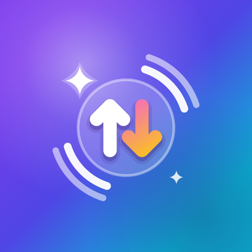</a>
**[MegaShare](https://megamind2999.github.io/MegaShareApk/)**: share files from Android with any phone or computer over Wi-Fi or hotspot. They only need a browser: no app, no internet, no account.
 

## Feedback

Found a bug or have an idea? [Open an issue](https://github.com/MegaMind2999/MegaDoApk/issues).

---

© 2026 MegaMind. All rights reserved. MegaDo is free for personal use; see the [Terms of Use](terms.html).
