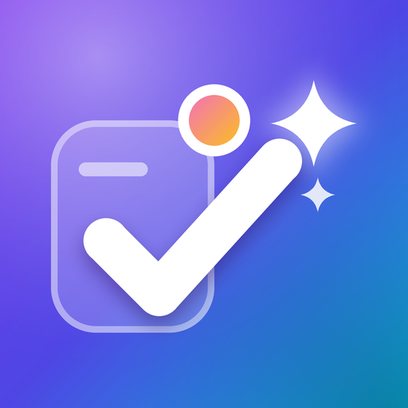
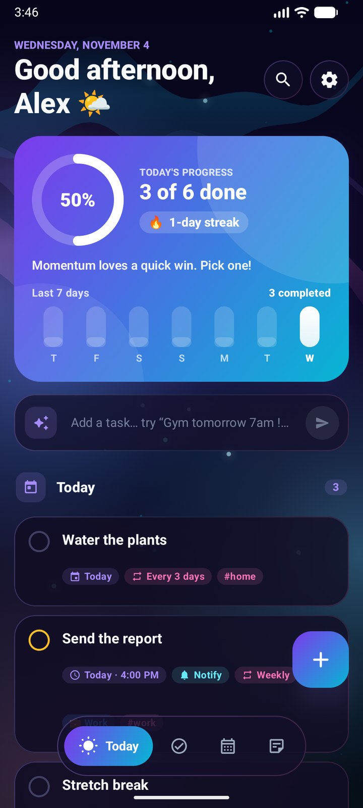
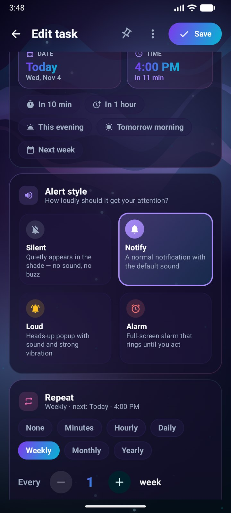
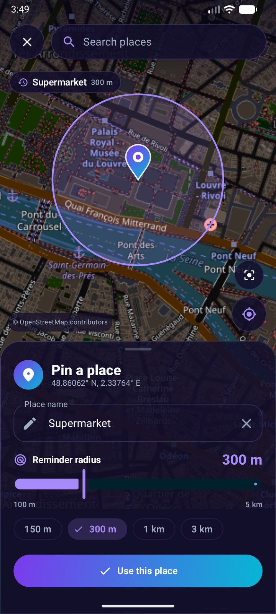
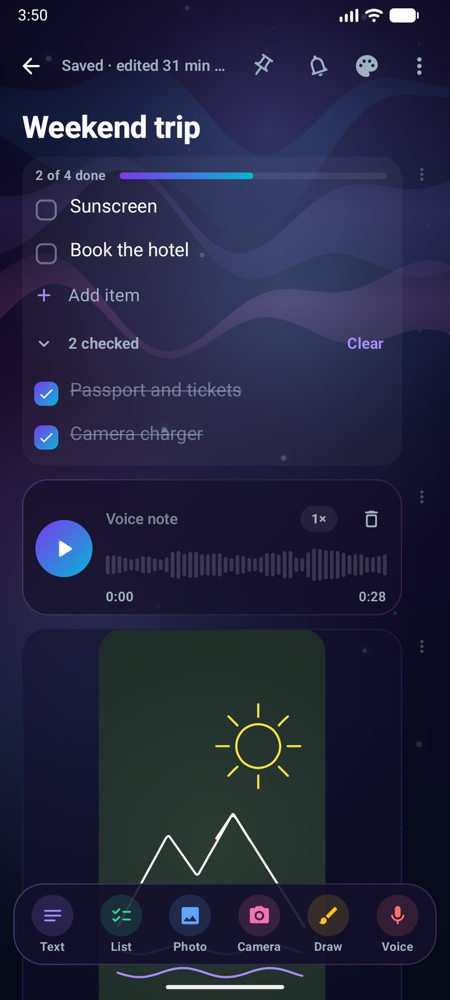
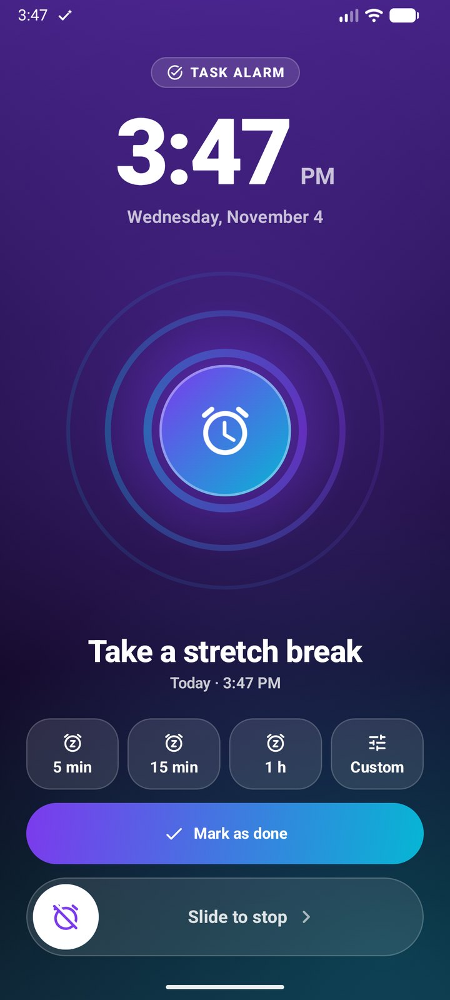
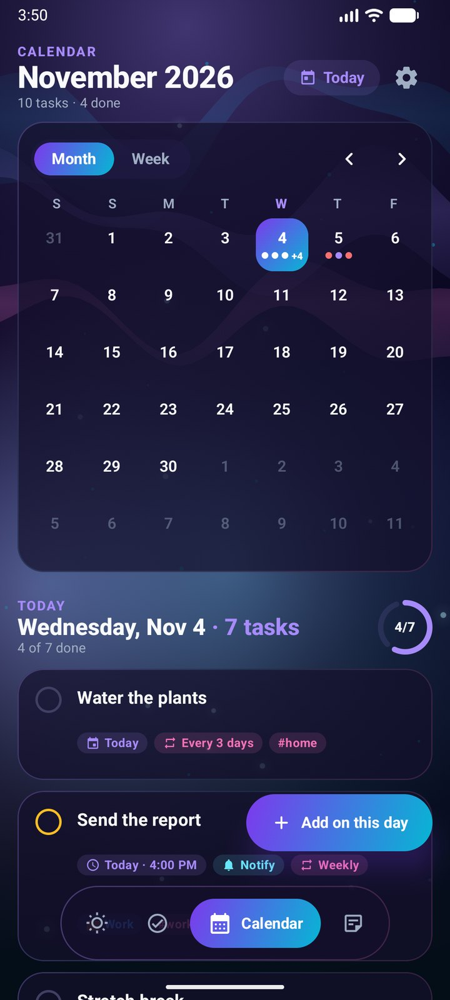

  

<h1 align="center">MegaDo</h1>

<b>To-do list, notes and reminders for Android</b> 
Alarms with snooze · location reminders · notes with photos, drawings and voice · sync between devices through your own Google Drive

  <a href="https://github.com/MegaMind2999/MegaDoApk/releases/latest/download/MegaDo.apk"><b>⬇ Download MegaDo.apk (latest)</b></a>
  &nbsp;·&nbsp;
  <a href="https://github.com/MegaMind2999/MegaDoApk/releases/latest">Release notes</a>
  &nbsp;·&nbsp;
  <a href="https://megamind2999.github.io/MegaDoApk/">Website</a>

Free · No ads · No tracking · Android 7.0+ · phones and tablets

---

## What is MegaDo?

MegaDo puts your to-do list, your notes and your reminders in one place. Add a task in plain words like *"Call mom tomorrow 5pm"* and MegaDo fills in the date, time and reminder. Choose how loudly each reminder gets your attention, from a quiet notification to a full-screen alarm, snooze it for as long as you like, or have it remind you when you arrive somewhere instead of at a time.

Notes can mix text, checklists, photos, hand drawings and voice recordings. Everything lives on your device, and if you use more than one, MegaDo keeps your phone and tablet in sync through a hidden folder in your own Google Drive.

  
  
  
  
  
  

## Features

**Tasks**
- Lists, subtasks, priorities, tags and pinning
- Today view with overdue, today and the next 7 days, plus your streak and weekly progress
- Quick add in plain words: "Groceries every week", "Standup every weekday at 9:30"
- Calendar by month or week, and search across tasks and notes
- Home-screen widget to check off today's tasks

**Reminders**
- Alert style per reminder: silent, notification, loud, or full-screen alarm
- Snooze for minutes, hours or a custom time
- Repeat every few minutes, hourly, daily, weekly on chosen days, monthly or yearly, with an optional end date
- "Keep reminding me until done" re-alerts every few minutes
- Location reminders: draw a circle on the map, get reminded when you arrive or leave

**Notes**
- Text, checklists, photos, camera shots, drawings and voice recordings in one note
- Drawing canvas with brushes and colors; voice recorder with waveform playback
- Pin, color, tag and archive

**Everything else**
- Two-way sync between devices through your own Google Drive, media included
- Backup to a single file and restore; trash keeps deleted items for 30 days
- Light and dark themes, accent colors and animated backgrounds; phone and tablet layouts
- Battery friendly: no polling, batched background work, animations pause when not visible
- Private: no accounts, ads, analytics or servers

## Install

1. Download [**MegaDo.apk**](https://github.com/MegaMind2999/MegaDoApk/releases/latest/download/MegaDo.apk) on your Android phone or tablet.
2. Open it and, if Android asks, allow installing apps from your browser or file manager.
3. To update, install the newer APK over the old one. Your data is kept.

## Sync your phone and tablet

Open **Settings → Sync → Sync with Google Drive** on each device and choose the same Google account. MegaDo only gets access to its own hidden folder in your Drive and can't see your other files. Your data goes straight to your Drive and never to the developer.

## Privacy and terms

- [Privacy Policy](https://megamind2999.github.io/MegaDoApk/privacy.html)
- [Terms of Use](https://megamind2999.github.io/MegaDoApk/terms.html)

## Feedback

Found a bug or have an idea? [Open an issue](https://github.com/MegaMind2999/MegaDoApk/issues).

---

© 2026 MegaMind. All rights reserved. MegaDo is free for personal use; see the [Terms of Use](terms.html).
